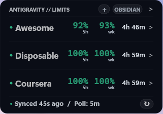
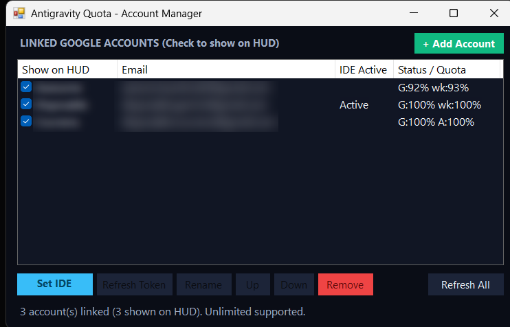
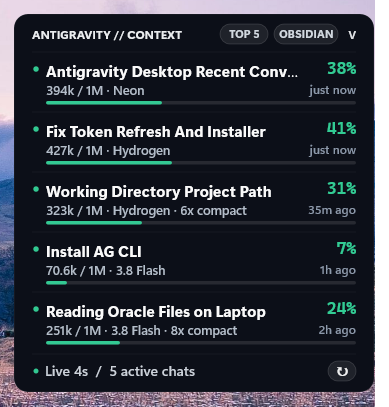

# Rainmeter Skins for Google Antigravity

[](https://www.rainmeter.net/)
[](https://microsoft.com/windows)
[]()
[]()
[]()
[](LICENSE)

A curated collection of modern, developer-centric desktop HUDs and widgets for [Rainmeter](https://www.rainmeter.net/), purpose-built for **Google Antigravity** power users and AI engineers.

Each skin is completely **independent and decoupled**—install and position either skin individually, or dock them side-by-side to create a comprehensive command center on your desktop.

---

## 📦 Available Skins

| Skin | Description | Quick Link |
| :--- | :--- | :--- |
| **`antigravity-limits`** | **Real-Time Quota & Rate Limit HUD**: Monitors Gemini, Claude & GPT, and Gemini 4 Argon 5-hour and weekly quotas across unlimited Google accounts with a dedicated Windows Account Manager and dynamic token health alerts. | [View Documentation](antigravity-limits/README.md) |
| **`antigravity-context`** | **Real-Time Context Window HUD**: Monitors token usage, model capacities (`1M` / `200k`), active models, and compaction history (`/compact`) across your Top 3, 5, or 8 recent Antigravity Desktop conversations. | [View Documentation](antigravity-context/README.md) |

---

## 📸 Previews

### 1. Quota & Limits HUD (`antigravity-limits`)
> Real-time 5-hour and weekly quotas, multi-account token management, and instant expiration alerts.

| Collapsed Mode | Expanded Detailed View | Dedicated Account Manager |
| :---: | :---: | :---: |
|  |  |  |

---

### 2. Context Window HUD (`antigravity-context`)
> Live token telemetry across active conversations, true model window scaling, and compaction tracking.

| Obsidian Theme (Dark) | Frost Theme (Light) | Compact Single-Chat Mode |
| :---: | :---: | :---: |
|  |  |  |

---

## 🚀 Getting Started

### Prerequisites
- [Rainmeter 4.5 or newer](https://www.rainmeter.net/) installed on Windows 10 or 11.
- Google Antigravity Desktop or CLI.

### Installation

1. **Clone or Download the Repository**:
   ```cmd
   git clone https://github.com/ayush1920/rainmeter-skins.git
   cd rainmeter-skins
   ```

2. **Install Either (or Both) Skins**:
   - To install the **Quota HUD**:
     ```cmd
     cd antigravity-limits
     install.bat
     ```
   - To install the **Context Window HUD**:
     ```cmd
     cd antigravity-context
     install.bat
     ```

Each `install.bat` automatically:
- Detects your active Rainmeter skins directory.
- Copies the skin assets and compiled helper binaries.
- Configures default settings without overwriting your credentials.
- Refreshes Rainmeter and activates the HUD immediately on your desktop.

---

## 🔒 Privacy & Security

- **`antigravity-limits`**: All OAuth refresh tokens are encrypted on disk using the **Windows Data Protection API (DPAPI)** keyed exclusively to your Windows user account. Tokens are refreshed securely over HTTPS with Google's official OAuth servers.
- **`antigravity-context`**: Operates **100% locally and offline**. It reads local session files (`transcript.jsonl` and `agyhub_summaries_proto.pb`) on your hard drive with zero network telemetry or internet requests.

---

## 📄 License

All skins and tools in this collection are open source and licensed under the [MIT License](LICENSE).
