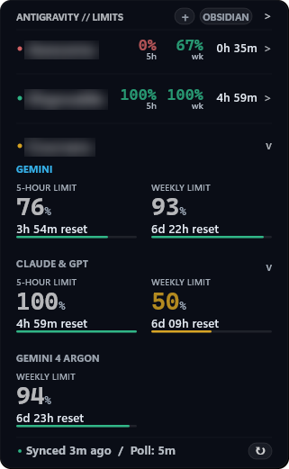

# Rainmeter Skins

A curated collection of modern, functional, and developer-centric desktop HUDs and widgets for [Rainmeter](https://www.rainmeter.net/).

---

## 📸 Previews (`antigravity-limits`)

| Compressed Mode | Expanded Mode |
| :---: | :---: |
|  |  |

---

## 📦 Available Skins

| Skin | Description | Quick Link |
| :--- | :--- | :--- |
| **`antigravity-limits`** | Real-time desktop telemetry HUD for **Google Antigravity** quotas (Gemini, Claude & GPT, Gemini 4 Argon) across unlimited Google accounts with a dedicated Windows Account Manager. | [View Skin & Setup](antigravity-limits/README.md) |

---

## 🚀 Getting Started

To install any skin from this repository:

1. Clone or download this repository:
   ```cmd
   git clone https://github.com/ayush1920/rainmeter-skins.git
   ```
2. Navigate to the desired skin directory (e.g. `antigravity-limits/`).
3. Run the automated installer (`install.bat`), which detects your Rainmeter installation and sets everything up with one click.

---

## 📄 License

All skins in this collection are licensed under the [MIT License](LICENSE).
