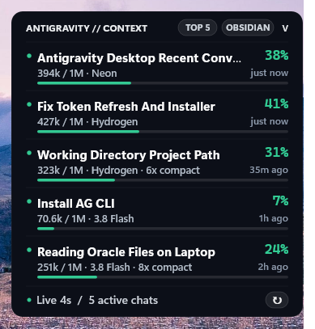
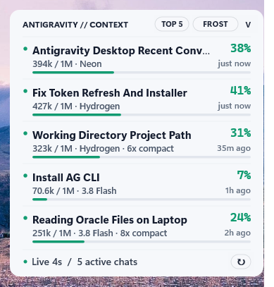
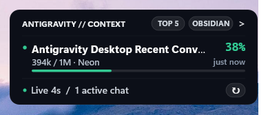

# Google Antigravity Context Window HUD for Rainmeter

[](https://www.rainmeter.net/)
[](https://microsoft.com/windows)
[]()
[]()
[](../LICENSE)

A standalone, high-readability desktop Rainmeter HUD that monitors **real-time context window usage**, **exact token counts**, **active models**, and **compaction history** across your **Top N most recent Google Antigravity Desktop conversations**—bringing live visibility similar to the Antigravity CLI (`/statusline` & `/context`) directly to your Windows desktop.

---

## 📸 Previews

| Obsidian Theme (Dark) | Frost Theme (Light) |
| :---: | :---: |
|  |  |

| Compact Mode (Active Chat Only) |
| :---: |
|  |

---

## ✨ Features

### 1. Real-Time Multi-Chat Context Tracking
- **Top 3 / Top 5 / Top 8 Conversations**: Click the **`TOP N`** pill in the header to cycle between showing your **Top 3**, **Top 5**, or **Top 8** most recently active Antigravity Desktop conversations.
- **Exact Model Context Window**: Displays live token usage and percentage against each active model's true context window (`1M` for Gemini models, `200k` for Claude/GPT models), plus a color-coded progress bar (**Green** `< 50%`, **Amber** `50%–79%`, **Red** `>= 80%`).
- **4-Second Live Polling (Zero Network)**: Scans local Antigravity transcript logs every **4 seconds** with file `(LastWriteTicks, FileLength)` caching—idle ticks perform **zero** file reads and **zero** Rainmeter redraws.

### 2. Compaction-Aware (`/compact` & Auto-Compaction)
- Tracks exact live prompt occupancy (`input_tokens + cache_read_tokens + output_tokens`) on every `PLANNER_RESPONSE` step.
- Detects `CHECKPOINT` compaction steps from manual `/compact` or automatic compaction: immediately adjusts resting context to `base_system_tokens + CHECKPOINT.output_tokens` and displays the session's compaction count (e.g., `6x compact`).

### 3. Official Desktop Titles & Multi-Profile Support
- **Native Sidebar Titles**: Extracts official conversation titles directly from Antigravity's `agyhub_summaries_proto.pb` (falling back to `chapter_titles/*.pb` and the initial `<USER_REQUEST>` for brand-new chats).
- **Automatic Swarm Filtering**: Automatically excludes background subagents and swarm workers so only your real conversations appear.
- **Multi-Profile Discovery**: Automatically scans `~/.gemini/antigravity` as well as **AgVerse / MultiGravity** profile directories, deduplicating shared junctions cleanly by conversation ID.

### 4. Interactive Desktop Controls
- **Dual Themes**: 1-click toggle between **Obsidian** (dark) and **Frost** (light) via the header pill.
- **Collapse / Expand**: Click the header chevron (`v` / `>`) to collapse down to a sleek 1-chat bar showing only your most recent active conversation.
- **Opacity / Alpha Control**: Scroll your mouse wheel up or down anywhere on the widget to adjust background opacity in real time.
- **Hover Diagnostics**: Hover over any conversation title for a tooltip with the full untruncated title, token ratio, active model, compaction count, and last activity time.
- **Manual Refresh**: Click the **`↻`** button in the footer (or right-click → **Force Refresh Context**) for an instant rescan.

---

## 🚀 Quick Start / 1-Click Installation

1. Clone or download this repository:
   ```cmd
   git clone https://github.com/ayush1920/rainmeter-skins.git
   cd rainmeter-skins\antigravity-context
   ```
2. Double-click **`install.bat`** (or run it from Command Prompt):
   ```cmd
   install.bat
   ```
3. The installer automatically:
   - Detects your Rainmeter Skins folder (`Rainmeter.ini`, Registry, OneDrive, or Documents).
   - Copies all skin files, Lua layout scripts, and `ContextBridge.exe`.
   - Refreshes Rainmeter and activates `AntigravityContext\ContextHUD`.

---

## 🛠 Manual Installation

1. Copy the contents of `skin/` into your Rainmeter skins folder (`Documents\Rainmeter\Skins\AntigravityContext\` or `%OneDrive%\Documents\Rainmeter\Skins\AntigravityContext\`):
   ```text
   Rainmeter\Skins\AntigravityContext\
   ├── ContextHUD\
   │   └── ContextHUD.ini
   └── @Resources\
       ├── ContextLayout.lua
       ├── ChatsMeters.inc
       ├── LiveContext.inc
       ├── UserState.inc
       └── ContextBridge.exe
   ```
2. Open Rainmeter, click **Refresh All**, expand `AntigravityContext -> ContextHUD`, and click **Load**.

---

## 🏗 Building from Source

```cmd
cd antigravity-context\src
build.bat
```

Uses the built-in Windows .NET Framework C# compiler (`csc.exe`) with zero external dependencies and no Visual Studio required.

---

## 🔒 Privacy & Performance

- **100% Local & Offline**: `ContextBridge.exe` makes **zero** network requests and never touches OAuth tokens or credentials. It only reads local `.gemini\antigravity` metadata and `transcript.jsonl` files in read-only shared mode (`FileShare.ReadWrite`).
- **Low Overhead**: Unchanged transcripts are skipped via `(LastWriteTimeUtc, FileLength)` metadata caching, and Rainmeter variables are only pushed when token counts or titles change.

---

## 📋 Requirements

- **Operating System**: Windows 10 or Windows 11
- **Rainmeter**: Version 4.5 or higher
- **Runtime**: .NET Framework 4.7.2+ (pre-installed on Windows 10/11)
- **Google Antigravity Desktop**: Active local profile with `.gemini\antigravity\brain\` logs

---

## 📄 License

This project is open-source under the [MIT License](../LICENSE).
