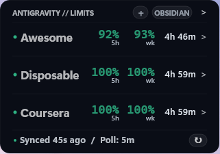
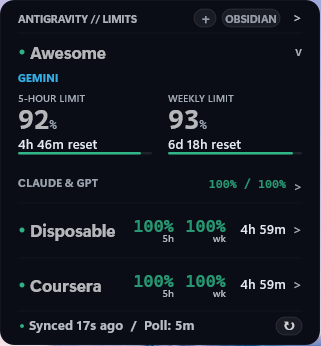
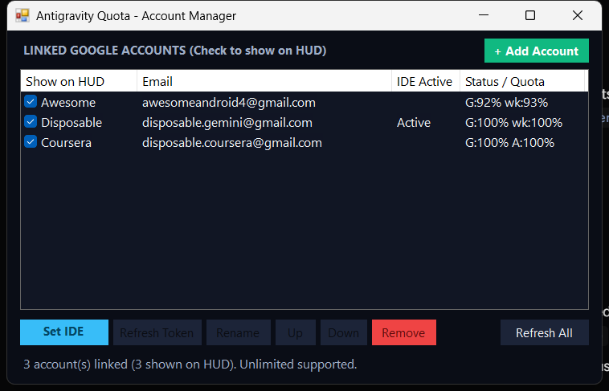
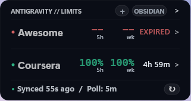

# Google Antigravity Limits & Quota HUD for Rainmeter

[](https://www.rainmeter.net/)
[](https://microsoft.com/windows)
[]()
[]()
[](LICENSE)

A modern, high-performance desktop telemetry HUD for **Google Antigravity** users, developers, and AI engineers. Monitor your **Gemini**, **Claude & GPT**, and **Gemini 4 Argon** 5-hour and weekly rate limits in real-time across **unlimited Google accounts** directly on your desktop.

---

## 📸 Previews

| Collapsed HUD | Expanded Detailed View |
| :---: | :---: |
|  |  |

| Account Manager UI | Token Expired Alert |
| :---: | :---: |
|  |  |

---

## ✨ Features

### 1. Complete Quota & Rate Limit Coverage
- **Gemini Models**: Real-time remaining percentage and countdown timers for both **5-Hour Limit** and **Weekly Limit**.
- **Claude & GPT Models**: Opus, Sonnet, and GPT rate limits with independent 5-hour and weekly tracking.
- **Gemini 4 Argon Support**: Automatically queries and renders the **Gemini 4 Argon Weekly Limit** for eligible paid/tier accounts using Antigravity Language Server telemetry (`antigravity/hub/2.34.0`).

### 2. Unlimited Multi-Account Management
- **Dedicated Account Manager UI**: Clean, resizable Windows dialog to manage all linked Google accounts in one place without cluttering your desktop right-click menu.
- **Show on HUD Checkboxes**: Check or uncheck accounts in the manager to toggle whether they appear on the HUD. The skin dynamically resizes and reformats immediately.
- **Set IDE Active Account**: One-click button switches the active authentication token in your Antigravity IDE (`~/.gemini/jetski-standalone-oauth-token` + Windows Credential Manager).
- **1-Click Google Sign-In**: Secure PKCE OAuth 2.0 flow via your default system browser with local loopback callback.

### 3. Token Health & Expiration Alerts
- **Refresh Token Button**: Built-in button in the Account Manager to force an immediate token refresh. If a token is revoked or expired, it automatically prompts you to re-authenticate seamlessly in your browser.
- **Instant Visual Alerts**: If any account's token expires or refresh fails, the HUD instantly alerts you:
  - Status dot turns **bright red** (`#ColorAccentRed#`).
  - Values render as high-visibility red **`--`** markers.
  - Reset timer displays **`EXPIRED`** or **`Token Expired`**.
  - Metric bars render as solid red lines.

### 4. Interactive Desktop Controls
- **Model Pinning**: Click any model header (`GEMINI`, `CLAUDE & GPT`, or `GEMINI 4 ARGON`) to pin it as the summary headline when the profile row is collapsed.
- **Expand / Collapse**: Click anywhere on an account row to expand its detailed metrics or collapse it down to a single compact line.
- **Dual Themes**: Toggle between **Obsidian** (dark / OLED theme) and **Frost** (light / glass theme) with one click on the header pill.
- **Opacity / Alpha Adjustment**: Scroll up or down anywhere on the HUD with your mouse wheel to adjust background transparency in real-time.
- **Auto-Sync & Manual Refresh**: Automatically polls Google Cloud Code API every 5 minutes in the background, or click the **↻** button in the footer for an instant telemetry update.

---

## 🚀 Quick Start / 1-Click Installation

The easiest way to install is using the automated installer batch script:

1. Download or clone this repository:
   ```cmd
   git clone https://github.com/ayush1920/rainmeter-skins.git
   cd rainmeter-skins\antigravity-limits
   ```
2. Double-click **`install.bat`** (or run it from command prompt):
   ```cmd
   install.bat
   ```
3. The script will automatically:
   - Locate your default Rainmeter Skins folder (via `Rainmeter.ini`, Registry, OneDrive, or Documents).
   - Copy all skin files, Lua layout scripts, and the compiled bridge binary.
   - Refresh Rainmeter and activate the `AntigravityQuota\QuotaHUD` skin.
   - Launch the Account Manager so you can add your first Google account!

---

## 🛠 Manual Installation

If you prefer to install manually:

1. Copy the contents of the `skin/` directory into your Rainmeter skins folder (typically `Documents\Rainmeter\Skins\AntigravityQuota\` or `%OneDrive%\Documents\Rainmeter\Skins\AntigravityQuota\`).
2. Your skin directory structure should look like:
   ```
   Rainmeter\Skins\AntigravityQuota\
   ├── QuotaHUD\
   │   └── QuotaHUD.ini
   └── @Resources\
       ├── HUDLayout.lua
       ├── AccountsMeters.inc
       ├── LiveQuota.inc
       ├── UserState.inc
       └── AntigravityBridge.exe
   ```
3. Open Rainmeter, click **Refresh All**, expand `AntigravityQuota -> QuotaHUD`, and click **Load**.
4. Click the **`+`** pill in the top header or right-click the skin and select **Manage Accounts...** to sign in.

---

## 🏗 Building from Source

To compile `AntigravityBridge.exe` from the provided C# source code:

1. Open a Command Prompt or PowerShell in `antigravity-limits\src\`.
2. Run `build.bat`:
   ```cmd
   build.bat
   ```
   *Uses the native .NET Framework C# compiler (`csc.exe`) built into Windows 10 and 11. No Visual Studio installation required!*

---

## 🔒 Security & Privacy

- **Encrypted Local Vault**: All OAuth access tokens and refresh tokens are protected using **Windows DPAPI** (`DataProtectionScope.CurrentUser`) stored locally in `%LOCALAPPDATA%\AntigravityQuota\vault.dat`. Only your Windows user account can decrypt them.
- **Direct Official Endpoints**: All quota calls are made directly to Google Cloud Code endpoints (`https://daily-cloudcode-pa.googleapis.com/v1internal:retrieveUserQuotaSummary`) over HTTPS TLS 1.3. No third-party servers, intermediate proxies, or external tracking.

---

## 📋 Requirements

- **Operating System**: Windows 10 or Windows 11 (64-bit recommended)
- **Rainmeter**: Version 4.5 or higher
- **Runtime**: .NET Framework 4.7.2+ (pre-installed on all modern Windows installations)

---

## 📄 License

This project is open-source under the [MIT License](LICENSE).
